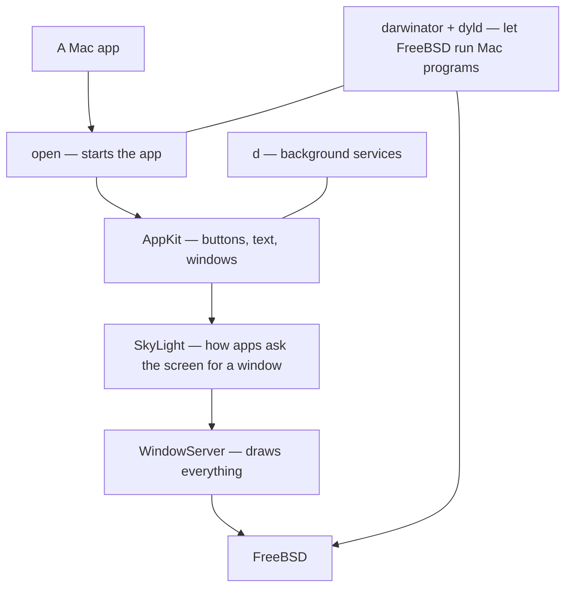

# How the pieces fit

| repository | one line |
|---|---|
| `darwinator` | the kernel module that runs Mach-O programs |
| `dyld` | the loader side: `machrun`, the cache tools |
| `macdeps` | takes what Apple owns from *your* Mac (scripts and lists only) |
| `IOKit` | the hardware registry and input stubs the Mac programs ask for |
| `d` | launchd, notifyd, wsbridge, LaunchServices, other daemons |
| `WindowServer` | WindowServer: compositor, input, IPC |
| `SkyLight` | the window protocol (wire, handlers, client shim) |
| `QuartzCore` | CoreAnimation |
| `CoreUI` | the reader of `.car` asset files |
| `AppKit` | our AppKit |
| `open` | `open App.app` and the stand-in libraries |
| `SDK` | compatibility frameworks |
| `LaunchServices` | icons, file types, pictures |
| `apps` | Dock, Finder, menu bar, login window, Terminal, TextEdit |
| `iso` | builds the installer image |
| `tests` | runs real Mac apps and checks the result |
| `research` | notes, dumps, experiments |

## Compatible, not similar (the rule behind every piece)
pearOS is an open-source implementation of macOS, not a lookalike.  When a framework or a daemon has a counterpart on the Mac, ours speaks **the same wire protocol** (MIG subsystems, XPC messages, shared-memory layouts), the same API and ABI, the same file formats and the same preference files, found by decompiling the real one and observing a real Mac, and never a protocol of our own that "does the same".  The check is two-way: a real Apple client works against our daemon, and our client works against the real daemon on a Mac.  Examples that exist: the WindowServer speaks SkyLight's real messages; the Control Center reads and writes the real layout file (`com.apple.controlcenter.bentoboxes`) and takes its list of controls from chronod's real database; the event taps are delivered as the real `CGYEventTap` messages.

## Display changes (resolution)
When the connector's mode changes (a VM window resized) the window server (KMS backend) sets the new mode, resizes its surfaces and tells the clients the way the real one does: the notifications 100, 114 and 115 that SkyLight's `initDisplays` registers in every process (`SkyLight/docs/DISPLAY-RECONFIGURATION.md`, decompiled), so that AppKit's `NSApplicationDidChangeScreenParametersNotification` reaches the Finder's desktop window, the Dock and the menu bar.  Until that path is verified on the Mac clients the Dock, SystemUIServer and Finder are also restarted.
